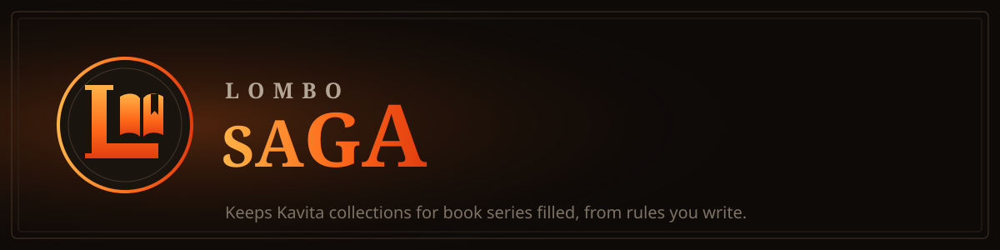

<p align="center"></p>

<p align="center">
  <a href="LICENSE"></a>
  <a href="https://github.com/Lombo-Forge/lombo-saga/actions/workflows/ci.yml"></a>
  <a href="https://github.com/Lombo-Forge/lombo-saga/actions/workflows/codeql.yml"></a>
  <a href="https://github.com/Lombo-Forge/lombo-saga/releases"></a>
  
  <a href="https://ko-fi.com/datlombardo"></a>
</p>

# LomboSaga

Keeps Kavita collections for book series filled, from rules you write.

> **Status: skeleton, not built.** The code is still the template's example, so it does not do the above yet and there is
> nothing to install. The plan is in [docs/architecture.md](docs/architecture.md#what-it-will-do).

## Contents

- [What is here](#what-is-here)
- [Develop](#develop)
- [Contributing and licence](#contributing-and-licence)

## What is here

The Lombo-Forge starting point: settings from `LOMBO_SAGA_*` variables, `doctor`, a dry-run `plan`, webhook
alerts, tests against a fake server, a container and CI. It will need Kavita.

## Develop

```sh
pip install -e '.[dev]' && pytest -q --cov
```

## Contributing and licence

Contribution, security and conduct rules come from the [Lombo-Forge organisation](https://github.com/Lombo-Forge/.github). Licensed under [GPL-3.0](LICENSE). Credits are in [NOTICE.md](NOTICE.md). Not affiliated with or endorsed by the Jellyfin project.
